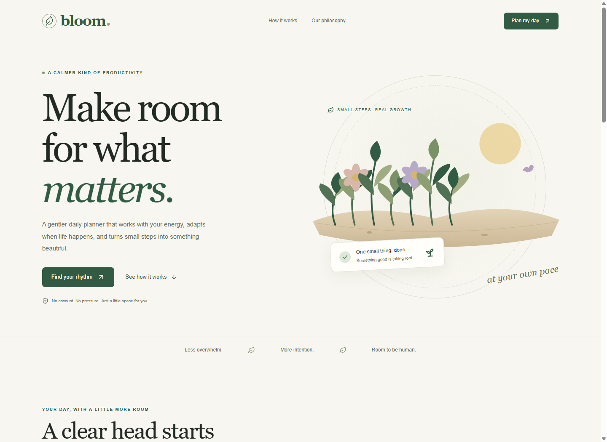
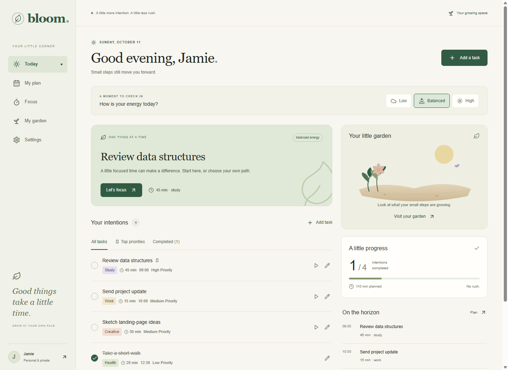

# Bloom

https://bloom-five-smoky.vercel.app

A calmer, more human way to manage your life. A responsive, local-first personal planner with energy-aware suggestions, a focus timer, and an original botanical progress garden.

## Run locally

Use Node.js **22.18 or newer** (the built-in TypeScript test runner needs it), and npm.

```sh
npm install
npm run dev
```

Open http://localhost:3000. No account, environment variables, API keys, database, or paid services are needed. System fonts and local SVG artwork keep the interface independent of remote asset fetching.

## Commands

| Command | Purpose |
| --- | --- |
| npm run dev | Start the development server |
| npm run lint | Check Next.js and TypeScript lint rules |
| npm run typecheck | Check TypeScript |
| npm test | Run meaningful domain tests using Node's built-in runner |
| npm run build | Generate the production build |
| npm start | Serve the production build |

## Routes and demo journey

- **/**: marketing page, product preview, philosophy, and working explainer anchors. The primary action goes to onboarding or Today based on saved preferences.
- **/app/onboarding**: four short steps for name, focus areas, self-reported energy, and planning style. Skip setup or opt into editable sample tasks.
- **/app/today**: add, edit, pin, reprioritize, complete, reopen, delete, and reschedule intentions; change energy; see real progress; deliberately replan unfinished tasks.
- **/app/plan**: navigate dates, use an accessible agenda, and edit task date/start time. Leave the start time empty to unschedule. Capacity and time conflicts produce gentle, honest feedback.
- **/app/focus**: choose a task, set a duration, start/pause/resume/reset, then take a break or mark the task complete. Countdown is based on a wall-clock deadline and intervals are cleaned up on unmount.
- **/app/garden**: see permanent growth, actual last-seven-day totals, meaningful wins, and saved reflections.
- **/app/settings**: update name, goals, planning style, focus duration, start time, daily capacity, and reduced motion. Export JSON, add/remove sample tasks, or deliberately clear all local data.

Try onboarding with the sample plan, select low energy, add a task, complete it, schedule another in My plan, pause a focus session, visit the garden, then replan unfinished tasks.

## Architecture

- Next.js App Router, React, TypeScript, Tailwind CSS, Lucide, and GSAP. Exact dependency versions are pinned to packages available in this offline development environment: Next.js 14.2.35, React 18.3.1, Tailwind 3.4.19. This is not a claim that these are the newest releases. Review framework upgrades and current security advisories before public deployment.
- app/ contains conventional route files and the shared layout. components/ contains the shell, task dialogs/cards, energy controls, garden artwork, focus timer, and scoped animation wrappers.
- lib/model.ts defines types and deterministic planning/progress rules. lib/storage.ts centralizes versioned defensive local-storage parsing. components/provider.tsx hydrates only after mounting, syncs tabs, and reports storage failures.
- Dates are local YYYY-MM-DD keys; start times are local 24-hour HH:mm values, separate from UTC creation/completion timestamps. Replanning wraps work extending past midnight into the next date.
- Energy ordering is optional guidance. Low favors shorter work, then pinned/high-priority tasks; balanced favors pins and priority; high additionally favors longer work within equal priority. Suggestions never mutate explicit scheduling or hide tasks. A preferred capacity is a guide, not an enforced limit.
- Each task's first completion adds a permanent growth event, independent of the task. Reopening, deleting, and taking time off do not remove growth. Repeating completion cannot earn duplicate growth. The illustration adds one plant per event up to 11, with leaves and flower variety; the earned milestone count continues beyond that. Weekly wins count first completions; weekly focus minutes sum persisted sessions in the last seven local calendar days.
- Focus sessions are recorded on completion; resetting a partly completed session saves its elapsed focus time. Leaving the focus route cancels the timer and leaves the task untouched; an unfinished session abandoned by navigation is not added to weekly totals.
- Reflections are saved explicitly and keyed by local date. Past entries from the last seven days are viewable on the garden page.
- GSAP uses scoped contexts and cleanup. Device reduced motion and the manual preference suppress nonessential movement. Native dialogs provide modal focus containment, Escape dismissal, and focus return. Navigation, task editing, scheduling, and replanning are keyboard accessible; no drag-only actions.

## Data and privacy

All user data stays in this browser under bloom.local.v1. Browser storage is not cross-device sync, encryption, or a backup. Clearing browser/site data removes it. Settings can export a JSON copy; importing backups is not included. Sample tasks are explicitly labeled and editable. Removing the sample plan removes tasks still carrying the original sample note; change that note to keep an edited example.

## Vercel deployment

1. Push this project to a GitHub, GitLab, or Bitbucket repository. The included .gitignore excludes dependencies, build outputs, local logs, and .env secrets.
2. Sign in to Vercel and import that repository as a new project.
3. Select the project root as the root directory.
4. Let Vercel detect **Next.js**. Keep default install/build commands and output settings; no custom vercel.json or output directory is required. Choose a Node runtime satisfying the package engine.
5. No environment variables are required. Deploy and inspect the production URL on desktop and mobile.
6. Push future commits to trigger deployments automatically.

Optional CLI: run `npx vercel` from the project root to link it and create a preview; use `npx vercel --prod` for production after reviewing the preview.

Vercel Hobby is intended for personal/noncommercial projects; limits and terms can change. Check https://vercel.com/docs/plans/hobby before deployment. No deployment has been executed by this build task.

## Verification

See VERIFICATION.md for commands actually run and any environment limitations. Before submission, follow the demo journey at 320px, 390px, 768px, and desktop widths; confirm refresh persistence, keyboard focus, reduced motion, timer completion, and storage-clearing confirmation. Test on the final deployed origin because local storage is origin-specific.

## Preview





A mobile dashboard preview is available at docs/today-mobile-preview.png.

## Motion and interactive showcase

The landing page includes an energy playground with three sample plans and a reversible completion interaction, native keyboard-accessible FAQ disclosures, reading progress, and a back-to-top link. The playground never edits the user's tasks or energy setting.

GSAP is imported asynchronously after hydration and shared across animation components. Hero and route entrances, staggered section reveals, botanical growth, pointer-driven card tilt/lift, and CTA icon movement use transforms and opacity. IntersectionObserver triggers reveals once and disconnects afterward; the hero uses a slow ambient loop that pauses outside the viewport and whenever the tab is hidden. Pointer interactions only run on desktop fine pointers, reuse quickTo tweens, and coalesce movement into animation frames. Reading progress uses a passive scroll listener with one scheduled frame. Cleanup removes observers, listeners, frames, and GSAP contexts on unmount or preference changes. Content starts visible, including if the animation chunk fails to load.

Use the floating Reduce motion button or Settings to save a preference. The system reduced-motion setting always takes precedence and is observed live. Touch devices keep the interactive demo and disclosures without pointer effects.

Inside the planner, click Find your next step or press Ctrl/Command+K (or / outside editable fields). Search pages and unfinished tasks, use arrow keys and Enter to navigate or start task focus, and Escape to close. The palette is loaded only when opened and restores focus on dismissal.

The browser regression script checks demo isolation, preference changes, FAQ expansion, keyboard navigation, task search, focus restoration, and all routes at 320, 390, 768, and 1280 pixels. Run it against a local server with node scripts/browser-check.mjs; it uses the locally installed Chrome path documented in the script.

## Color and page transitions

Lilac, coral, butter yellow, and mint now carry through the hero, section backgrounds, dimensional cards, and individual planner destinations. SVG botanical bursts add movement without new image or animation dependencies. Section icons spring into view, and emphasized headings rise into place.

Internal links to a different route use a four-panel GSAP curtain: cover, navigate, then uncover when the new pathname commits. Modified clicks, external links, downloads, same-page anchors, and dialog links keep their normal behavior. History and programmatic route changes also reveal through the color panels. A timeout releases the curtain if navigation does not commit. System and saved reduced-motion preferences disable the curtain and ambient loops immediately.

## Advanced scroll scenes

The moving text ribbon has been removed. ScrollTrigger loads asynchronously on the landing page and owns scroll-scrubbed hero parallax, a perspective product-preview reveal, the botanical path drawing, and the closing flower rotation. Desktop viewports at least 1024 px wide and 650 px tall also get a pinned three-step story with card handoffs and a progress rail. Smaller screens retain normal document flow and short card entrances. There is no scroll snapping or custom scrolling engine.

Fine desktop pointers get magnetic CTA buttons with reusable quickTo tweens and movement coalesced into animation frames. Each animated property has one owner to avoid conflicts between reveal, hover, and scroll effects. GSAP matchMedia restores pins, spacers, transforms, path styles, and listeners when reduced motion changes, the viewport crosses a breakpoint, or the page unmounts.

Run node scripts/scroll-check.mjs against a local server (optionally set BLOOM_BASE_URL) for real-browser checks of reverse scrolling, pin cleanup, repeated resizing, path drawing, product perspective, magnetic buttons, and route cleanup.

## Zoom journey, product tour, and starter rituals

The homepage has a layered scroll-driven zoom scene. On desktop, a pinned timeline enlarges a focus card, expands its circular backdrop, moves surrounding distractions away, and rotates the botanical accent. It reverses with scrolling; smaller screens use a short, unpinned scale reveal.

Explore the product opens a lazily loaded tour with Today, Focus, and Garden sample views. The preview supports 100–150% magnification, a reset that returns the viewport to its origin, sample task completion, focus-duration selection, and garden feedback. These interactions never write tasks or sessions. Native dialog dismissal restores focus.

The starter ritual builder offers gentle, focused, and creative routines with total duration. Reorder buttons animate with deferred GSAP Flip and retain keyboard focus. Add ritual to my day appends actual editable tasks for the local date, pins the first step, preserves existing tasks, and prevents duplicate routine steps even on rapid repeated clicks. Saved routines survive onboarding. Each routine may be added again on another date.

Scroll measurements refresh when the energy demo or ritual builder changes size. Resize and reduced-motion cleanup restore both pinned scenes without duplicate spacers. Run node scripts/showcase-check.mjs for feature, persistence, isolation, keyboard, and mobile zoom coverage.

## Cinematic GSAP layer

All of it lives in `components/` and is created inside `gsap.matchMedia`, so a resize across a breakpoint or **Reduce motion** reverts it cleanly. GSAP 3.15 ships every plugin free in the `gsap` package.

| File | What it does |
| --- | --- |
| `gsap-kit.ts` | One lazy loader that registers ScrollTrigger, SplitText, DrawSVG, MorphSVG, MotionPath, Draggable, Inertia, Observer and ScrollTo. |
| `cinematic-scenes.ts` | Owns every new scroll scene (see below). |
| `preloader.tsx` | Once-per-visit intro: leaf draws, wordmark rises, counter follows real page load, four panels lift. Skipped for returning visits, deep links, app routes and reduced motion (a tiny inline script in `app/layout.tsx` decides before first paint). |
| `cursor.tsx` | Trailing ring that grows over controls and shows labels for `data-cursor`. The real cursor stays visible. Fine pointers only. |
| `fullscreen-menu.tsx` | Full-screen menu: staggered panels, masked labels, hover preview tile, coordinated reverse exit, focus trap, Escape, ScrollTo navigation. |
| `showcase.tsx` | Markup for the new sections plus the draggable board. |
| `growth-shapes.ts` | Morph targets and colours. |

Scenes: masked letter-by-letter hero headline, kinetic section headings, layered hero depth (scroll and pointer), velocity-reactive marquee, horizontal day gallery (sticky, snapping, circular mask reveals, background wash, drag-to-scrub with Observer), stacked promise cards, scroll-lit statement with elastic skew, seed-to-bloom morph with MotionPath sparks and DrawSVG orbit, counters and a self-drawing chart, and a Draggable + Inertia board.

Accessibility and fallbacks: horizontal and sticky layouts are gated by `data-gallery-active` and `data-growth-active`, which only the scenes set, so reduced-motion and mobile visitors get a normal stacked page. The board has a button path for every drag. The "sample week" numbers are labelled as a sample.
